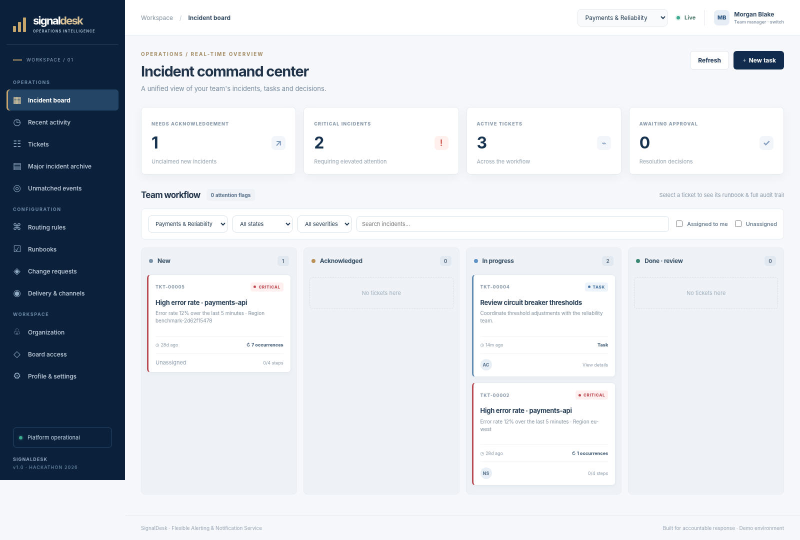

# SignalDesk

SignalDesk routes alerts to the team that owns the incident and groups repeat alerts into a single ticket. Teams define the matching rules, runbook and notification policy in configuration.



## Run the stack with Docker Compose

From the repository root, with a running Docker engine and Compose v2:

```bash
cd signaldesk
./start.sh
```

The script creates `.env` with a random session-signing secret on first use, then runs `docker compose up --build` in the foreground. Compose starts PostgreSQL, RabbitMQ, Mailpit, the FastAPI service and a separate worker. The API startup command seeds an empty database with teams, rules, runbooks and sample incidents. Existing volumes retain changes across restarts.

| Local endpoint | What to inspect |
| --- | --- |
| [SignalDesk](http://localhost:8000) | Choose a demo persona and open their workspace |
| [API docs](http://localhost:8000/api/docs) | Explore the HTTP contract and try requests |
| [Mailpit](http://localhost:8025) | Read email delivered by the worker over SMTP |
| [RabbitMQ management](http://localhost:15672) | Inspect the broker and its `signaldesk.events` queue |

Keep host ports **8000**, **8025** and **15672** available. In a second terminal in `signaldesk/`, use `docker compose ps` to inspect service status and `docker compose logs -f api worker` to follow processing. Stop the foreground run with Ctrl+C. Once `.env` exists, `docker compose up -d --build` runs the same stack in the background and `docker compose down` stops it while retaining its named volumes.

## Walk through an incident

This walkthrough uses the default seed data. If you are reviewing a previously modified demo, the teams and active rules may differ.

1. **Establish a baseline.** Choose a **Team manager** profile with access to the payments board. On **Incident board**, select **Payments & Reliability**. Find **High error rate · payments-api** and note its occurrence count.
2. **Generate a burst.** Use the profile menu in the upper right to switch to **Demo / debug**. In **Scenario lab**, choose **Critical · payments error rate**, set **Occurrences** to **5** and click **Inject events**. These events go through the same database-backed processor as webhook and broker traffic.
3. **Verify the routing decision.** After processing, the five entries in **Recent processing traces** should show `matched` and the same ticket ID. Switch back to the payments manager profile and open the original card. Its count should have increased by five. The payments rule identifies this incident using the alert name, service and region.
4. **Inspect the operator's evidence.** In the ticket, **Original event data** shows what the producer sent, **Runbook · next steps** gives the responder a procedure, and **Audit timeline** records work on the incident. Actions are scoped to the user's role and team. Runbook actions marked risky require manager authorization.
5. **Exercise the unmatched path.** Switch to **Demo / debug** and send one **Unmatched unknown schema** event. Open **Unmatched events** after processing to inspect the payload and routing attempts. This gives the team a concrete sample when deciding whether to add a rule.

## Send events through the external adapters

Run these commands from `signaldesk/` against the seeded stack. The webhook example returns an event ID on acceptance. Repeating it with the same `X-Event-ID` demonstrates source-level retry handling. Sending the same alert with a new ID creates a new occurrence that the payments rule can correlate with the open incident.

```bash
curl -fsS http://localhost:8000/api/ingest/webhook \
  -H 'Content-Type: application/json' \
  -H 'X-Event-ID: reviewer-payments-001' \
  --data-binary @fixtures/payments.json
```

The settlement fixture takes a separate path through RabbitMQ. The publisher runs inside the worker container so it can reach the broker on the Compose network. The consumer acknowledges the message after committing its raw event to PostgreSQL.

```bash
docker compose exec -T worker python -m app.adapters.broker_publish < fixtures/workflow.json
```

## Engineering decisions

| Concern | Implementation |
| --- | --- |
| Heterogeneous payloads | The worker derives canonical fields such as severity and service while retaining the original payload. Rules can also match nested producer-specific fields. |
| Deterministic ownership | Each source specifies an ordered team chain. The worker evaluates each team's rules in priority order and stops at the first match. The event retains its routing trace, including unsuccessful attempts. |
| Concurrent processing | PostgreSQL workers claim pending rows with `FOR UPDATE SKIP LOCKED`. A transaction-scoped advisory lock on the incident key serializes competing updates for the same incident. |
| Notification failures | Delivery jobs, attempt state and retry schedules are persistent. Policies select recipients and channels, with fallback after retry exhaustion. Mailpit captures SMTP locally. Phone and SMS use simulated adapters. |
| Operator access | FastAPI enforces permissions for team and ticket operations. The demo persona selector makes those roles accessible to reviewers. Server-Sent Events prompt the browser to refresh its authorized view. |

## Evidence and scope

The checked-in benchmark processed **600 events**, including a burst of **500 occurrences** that produced **one incident and four initial delivery jobs**. It used single-process SQLite and captured delivery channels. The report includes timings and workload parameters so reviewers can interpret the figures in that context. [Benchmark results](signaldesk/benchmark-results.json)

The [integration tests](signaldesk/tests/) cover routing, repeated alerts, recovery, permissions and ticket workflows. For a deeper review, see the [architecture guide](signaldesk/docs/ARCHITECTURE.md), [setup and test commands](signaldesk/README.md) and [requirement coverage and known gaps](signaldesk/docs/COMPLIANCE.md).
